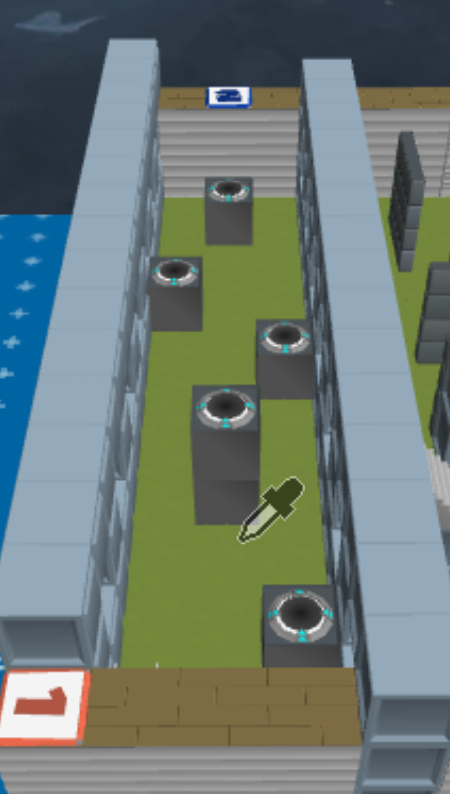
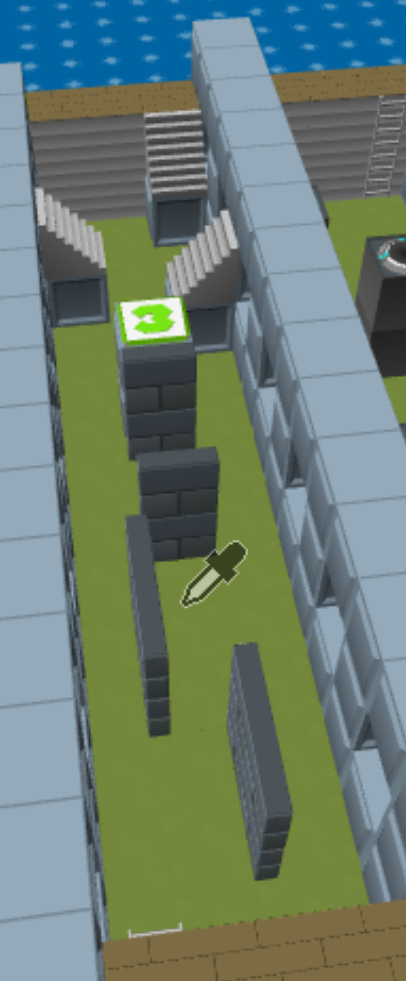
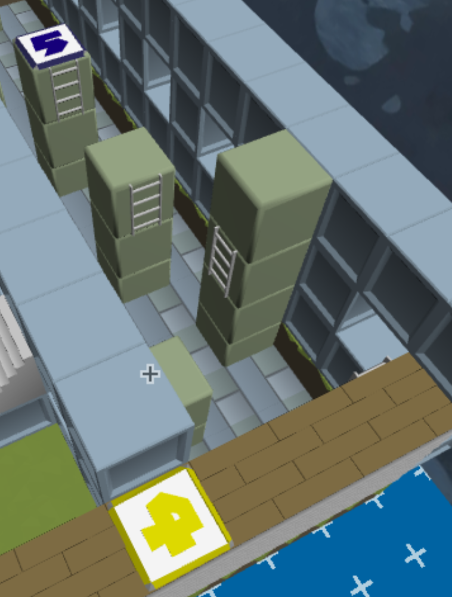
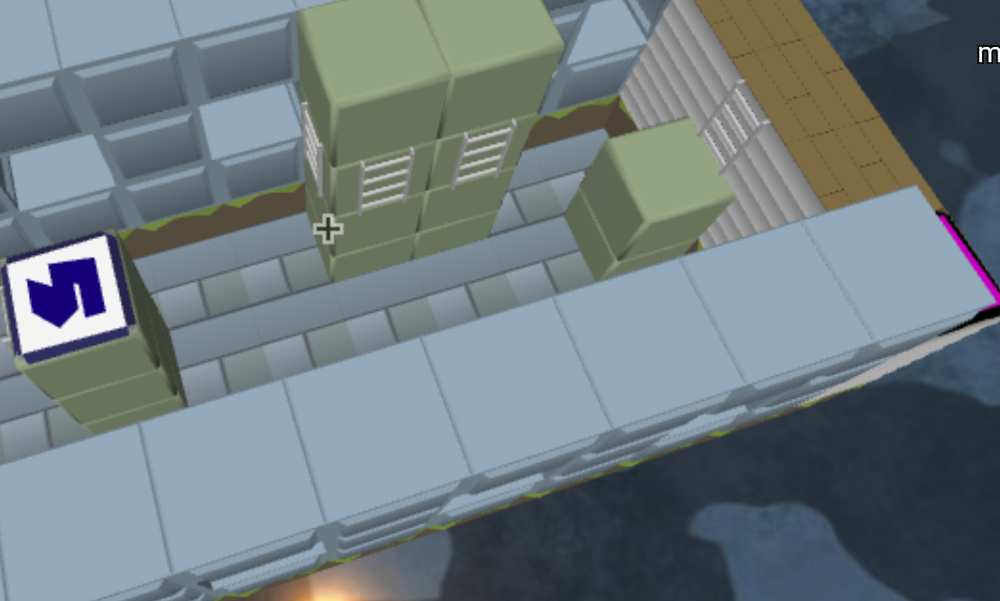

## Parkour Test Map B route guide

### 1 → 2: Jump-pad chain

- Leave checkpoint 1 and land on the first jump pad.
- Let each pad launch you toward the next raised pillar.
- Steer in midair to land near the center of each following pad; avoid treating the pillars as ordinary jump targets.
- Continue through the staggered pad sequence until the final launch carries you onto checkpoint 2.

The jump pads are a genuinely new traversal mechanic: touching one supplies the vertical launch rather than requiring a normal jump.

### 2 → 3: Rotated slab blocks

- Jump from checkpoint 2 onto the first thin, rotated slab.
- Use each slab’s actual narrow collision surface as the landing area, not its grid-cell center.
- Reorient after every landing because the slabs alternate position and angle.
- Progress from slab to slab, then climb the taller stacked slabs near the far end.
- Jump onto checkpoint 3 once level with its platform.

### 3 → 4: Ramp-only crossing

- Leave checkpoint 3 for the first isolated ramp.
- Land on the accessible low portion of each ramp.
- Walk or jump up its slope, using the high edge as the departure point for the next ramp.
- Repeat across the ramp chain; do not assume the empty space surrounding a ramp is a full standable cell.
- Use the final ramp to reach checkpoint 4.

### 4 → 5: Midair ladder catches

- Jump from checkpoint 4 toward the first wall-mounted ladder and catch it during the flight.
- Climb to the top.
- The ladder has a small but valid landable collision surface at its top. Settle onto that surface instead of assuming a full platform exists.
- Jump from the ladder top toward the next ladder, catch it in midair, and climb again.
- Repeat across the ladder pillars.
- From the final ladder top, jump onto checkpoint 5.

This section requires both ladder catches and ladder departures; a lone ladder attached to a wall is a valid stopping point because its top collision can support the player.

### 5 → Goal: Ladder corner transfer

- Jump from checkpoint 5 and catch the first ladder on the large solid structure.
- Climb and settle on the small collision surface at the ladder’s top.
- The solid block prevents a direct path to the next ladder.
- Jump outward and around the block’s corner, steering sideways while airborne.
- Catch the ladder mounted on the other face of the same structure.
- Climb that ladder and settle on its top collision.
- Jump from there onto the separate full block.
- Use the full block as the final stable takeoff point, then jump or walk to the goal platform.